## **Hola y bienvenido a mi perfil! 🦾**

Me llamo [Juan José]([https://github.com/atjos](https://open.spotify.com/playlist/5mhAT17LnVhyPJahgave9l?si=jhWl1bMPQ22loPGUGk1kqw)), soy estudiante de física y vivo en Colombia.
Apasionado por la ciencia, la computación y la estrecha relación que lleva a ambas a ser una gran herramienta en el desarrollo de nuevas ideas.

  

<picture>
  <source media="(prefers-color-scheme: dark)" srcset="https://raw.githubusercontent.com/atjos/atjos/output/github-snake-dark.svg" />
  <source media="(prefers-color-scheme: light)" srcset="https://raw.githubusercontent.com/atjos/atjos/output/github-snake.svg" />
  
</picture>

